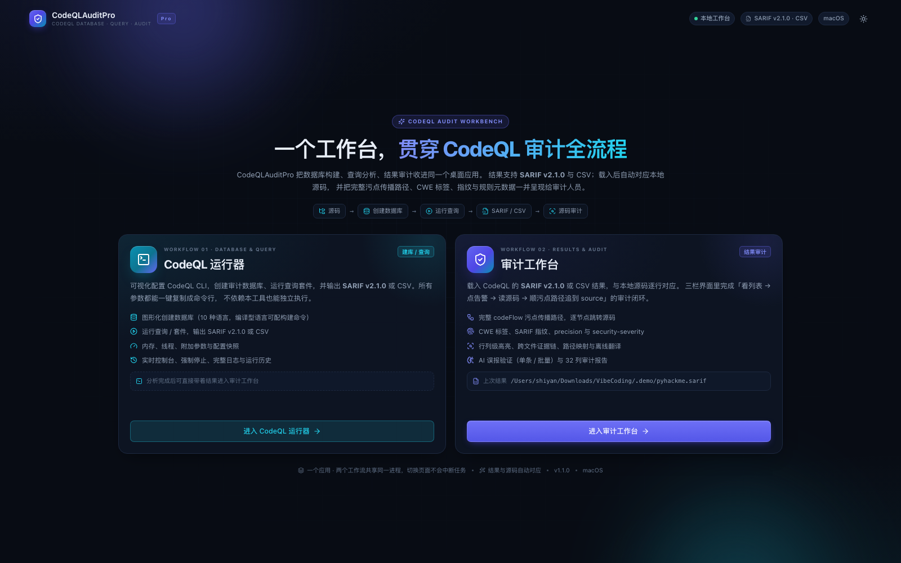
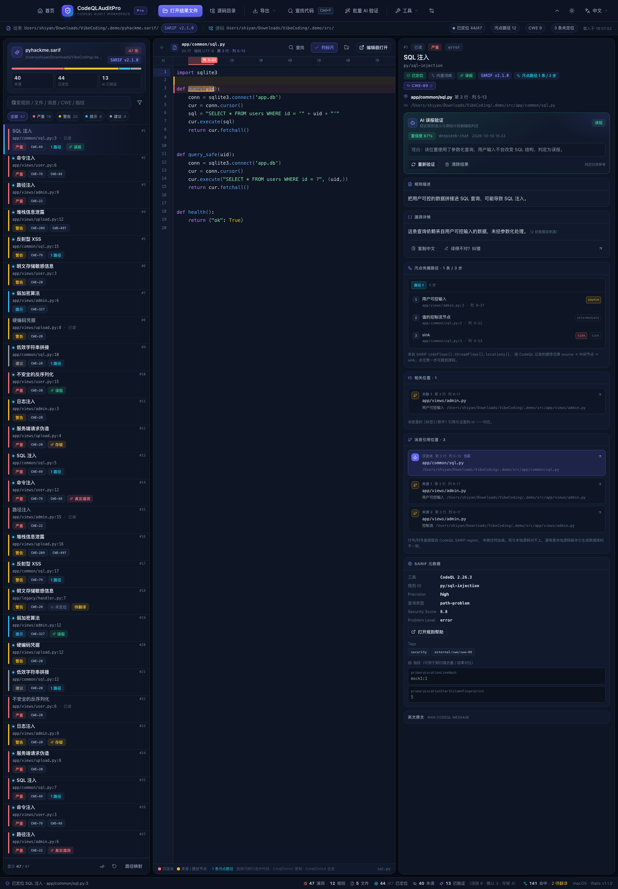
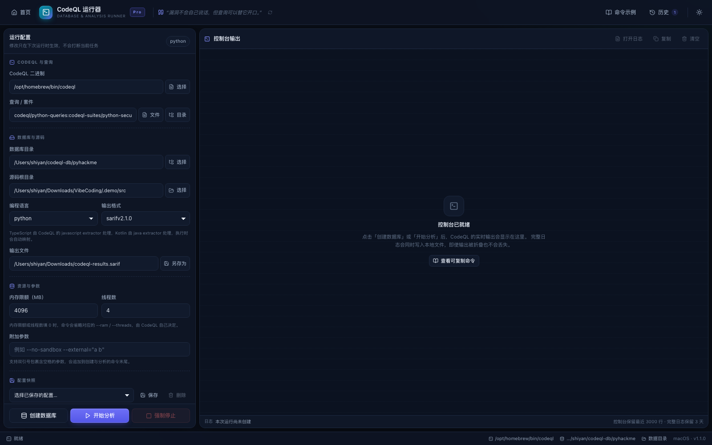
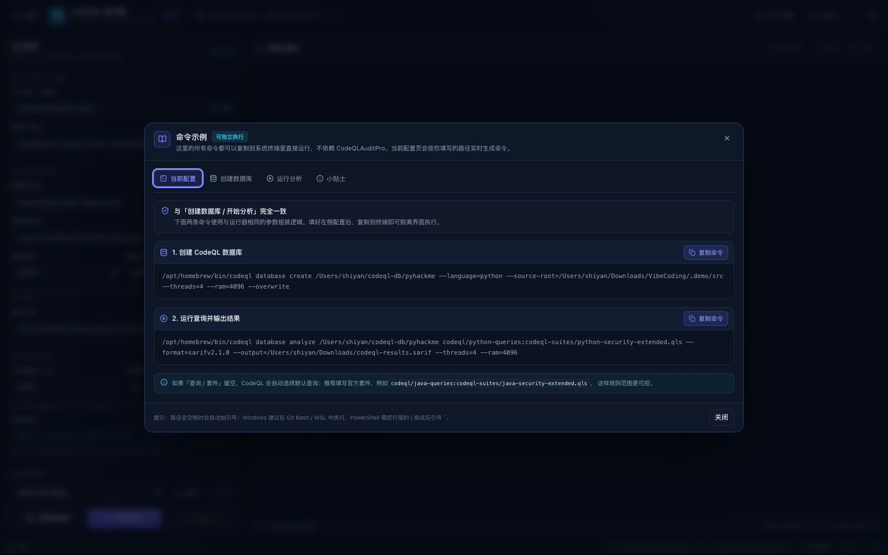
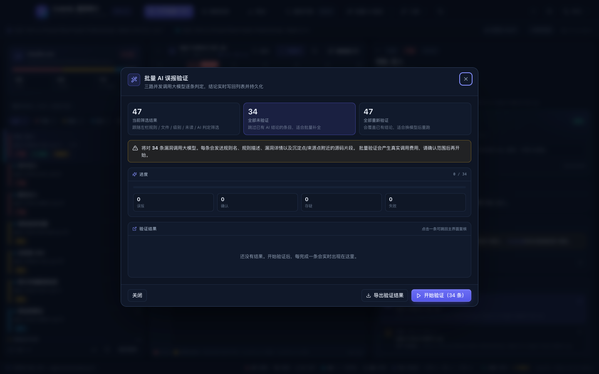

# CodeQLAuditPro

**一个面向安全审计人员的 CodeQL 桌面工作台：从创建数据库、运行查询，到载入 SARIF / CSV、对应源码、追踪完整污点路径，全部在一个应用里完成。**

[](https://go.dev)
[](https://wails.io)
[](https://react.dev)
[](https://www.typescriptlang.org)
[](https://docs.oasis-open.org/sarif/sarif/v2.1.0/sarif-v2.1.0.html)
[](#-快速开始)
[](#-开源许可)


<a href="docs/screenshot-hub.png">
  
</a>

---

## 目录

- [为什么是 CodeQLAuditPro](#-为什么是-codeqlauditpro)
- [功能亮点](#-功能亮点)
- [SARIF v2.1.0 支持](#-sarif-v210-支持)
- [界面截图](#-界面截图)
- [快速开始](#-快速开始)
- [使用指南](#-使用指南)
- [命令行模式](#-命令行模式)
- [项目架构](#-项目架构)
- [数据目录](#-数据目录)
- [隐私与安全](#-隐私与安全)
- [开发与测试](#-开发与测试)
- [Roadmap](#-roadmap)
- [参与贡献](#-参与贡献)
- [开源许可](#-开源许可)

---

## 为什么是 CodeQLAuditPro

CodeQL 的能力很强，但实际审计通常要在多个环节之间来回切换：

1. 用命令行创建数据库、选择查询套件、等待分析完成；
2. 从 SARIF / CSV 里翻找告警，再去 IDE 里定位源码；
3. 自己拼接污点路径、核对 CWE、判断是不是误报；
4. 最后整理成可交付的审计报告。

CodeQLAuditPro 把这些环节收进一个桌面应用，并围绕审计人员的实际操作组织界面：

- **工作流 01 · CodeQL 运行器**：可视化创建数据库、运行查询，输出 SARIF v2.1.0 或 CSV；
- **工作流 02 · 审计工作台**：载入结果与本地源码，逐行对应、追踪污点路径、标记已读、做 AI 误报验证、导出审计报告。

两个工作流共享同一个进程，切换页面不会停止正在运行的 CodeQL 任务，也不会丢失审计现场。

---

## 功能亮点

| 能力 | 说明 |
|---|---|
| **SARIF v2.1.0 + CSV** | 同时支持 CodeQL 的两种主流结果格式，按文件扩展名 / 文件头自动识别 |
| **完整污点传播路径** | 还原 SARIF `codeFlows` 的每一个节点，按 source → 中间节点 → sink 展示 |
| **CWE 与规则元数据** | 展示 CWE、`precision`、`kind`、`security-severity`、`problem.severity` 与规则帮助链接 |
| **SARIF 指纹** | 展示 `partialFingerprints` / `fingerprints`，并作为已读状态与 AI 判定的稳定键 |
| **源码对应** | 容器路径 / 相对路径 → 本地源码，支持前缀规则与单文件覆盖 |
| **行列级定位** | CodeMirror 6 代码视图，沉淀点、来源点、路径节点全部高亮并可跳转 |
| **跨文件跳转** | 点击消息内联链接、相关位置或路径节点，直接打开对应文件和行列 |
| **中文审计界面** | 规则名、描述、漏洞详情离线中文化，翻译库可人工校正 |
| **AI 误报验证** | 结合规则语义与源码片段，单条 / 批量验证并持久化结论 |
| **审计闭环** | 已读 / 未读、严重级别 / 规则 / 文件 / AI 判定筛选、跳转历史 |
| **可交付导出** | 中文 CSV、32 列审计报告、AI 验证结果 CSV |
| **CodeQL 运行器** | 建库、跑查询、实时控制台、完整日志、配置快照、可复制命令 |
| **命令行模式** | 不启动界面，直接解析 + 中文化 + 导出，便于批处理 |

---

## SARIF v2.1.0 支持

CSV 只有 9 列，CodeQL 在导出时已经把证据链压缩成消息文本；SARIF 则保留了完整的结构化数据。CodeQLAuditPro 会把这些字段全部解析出来，而不是只取「规则 + 位置」：

| SARIF 字段 | 在审计工作台中的用途 |
|---|---|
| `runs[].results[]` | 一条告警；规则、级别、消息、位置 |
| `tool.driver.rules[]` | 规则元数据：CWE、precision、kind、security-severity、帮助链接 |
| `properties.tags` | 提取 `external/cwe/cwe-089` 等标签，展示为可点击的 CWE |
| `codeFlows[].threadFlows[].locations[]` | 完整污点传播路径，逐节点展示与跳转 |
| `relatedLocations` | 相关位置列表；消息中的 `[标签](id)` 会变成可点击链接 |
| `partialFingerprints` / `fingerprints` | 指纹展示，并用于跨扫描稳定识别同一条告警 |
| `artifactLocation` + `region` | 把逻辑文件路径与行列映射到本地源码 |

载入 SARIF 后，右侧详情区会额外出现：

- **污点传播路径**：按 CodeQL 记录的顺序还原每一条路径，点击任意一步跳到源码；
- **相关位置**：`relatedLocations` 的标签、文件、行列；
- **SARIF 元数据**：工具版本、规则 ID、precision、查询类型、Security Score、Tags；
- **指纹**：`primaryLocationLineHash`、`primaryLocationStartColumnFingerprint` 等。

<a href="docs/screenshot-audit-sarif-full.png">
  
</a>

> CSV 仍然完整支持：同样的三栏界面、翻译、路径映射、AI 验证与导出能力都不会因为 SARIF 的加入而减少。

---

## 界面截图

### 工具选择首页

一个入口，两个工作流。进入任一工作台后，点左上角「首页」即可返回。


### 审计工作台 · SARIF


### 完整污点路径与 SARIF 元数据


### CodeQL 运行器



### 命令示例

按当前配置实时生成建库 / 分析命令，也可以复制按语言整理的成熟示例到终端独立执行。



### 批量 AI 验证



### 路径映射


浅色主题：


---

## 快速开始

### 环境要求

- **Go 1.25+**
- **Node.js 20+** 与 **pnpm 10+**
- **Wails CLI 2.16+**：`go install github.com/wailsapp/wails/v2/cmd/wails@latest`
- **CodeQL CLI**（工作流 01 需要）：`codeql` 可在 PATH 中，或在界面里指定绝对路径
- 平台依赖：
  - macOS：Xcode Command Line Tools
  - Windows：WebView2 Runtime
  - Linux：WebKitGTK 与 gcc

先确认 Wails 环境：

```bash
wails doctor
```

### 安装依赖

```bash
git clone https://github.com/sh1yan/codeql-audit-pro
cd codeql-audit-pro

# 前端依赖
make deps
# 或：cd frontend && pnpm install
```

### 开发模式

```bash
make dev
# 等价于 wails dev
```

`wails dev` 会同时启动 Vite 与原生窗口，React 代码热更新，Go 代码自动重新编译。

如果只想在浏览器里查看界面（使用内置 mock 数据，不需要后端）：

```bash
cd frontend
pnpm dev
# http://localhost:34115
```

### 打包

```bash
make build          # 等价于 wails build，产物在 build/bin/
make build-fast     # 跳过 pnpm install，只重建前端后打包
```

macOS 产物：`build/bin/CodeQLAuditPro.app`。

> macOS 首次从「下载」目录启动时，如果系统询问是否允许访问该目录，选择「允许」即可；
> 也可以把 `.app` 拖到 `/Applications` 或 `~/Applications` 后再启动。

---

## 使用指南

### 工作流 01 · 创建数据库与运行查询

1. 首页进入 **CodeQL 运行器**；
2. 填写 CodeQL 二进制、查询 / 套件、数据库目录、源码根目录；
3. 选择语言，点击 **创建数据库**，在右侧控制台查看实时日志；
4. 选择输出格式：
   - **SARIF v2.1.0**：推荐，审计工作台可以展示完整污点路径、CWE 与指纹；
   - **CSV**：兼容旧流程与轻量导出；
5. 指定输出文件，点击 **开始分析**；
6. 分析完成后，控制台上方会出现「用审计工作台打开」按钮，直接带着结果进入工作流 02。

命令行等价示例：

```bash
# 1. 创建 Python 数据库
codeql database create ~/codeql-db/py-demo \
  --language=python \
  --source-root=/path/to/python-project \
  --threads=4 --ram=4096 --overwrite

# 2. 运行官方安全套件，输出 SARIF v2.1.0（推荐）
codeql database analyze ~/codeql-db/py-demo \
  codeql/python-queries:codeql-suites/python-security-extended.qls \
  --download \
  --format=sarifv2.1.0 \
  --output=~/py-results.sarif \
  --threads=4 --ram=4096

# 3. 或输出 CSV（兼容旧流程）
codeql database analyze ~/codeql-db/py-demo \
  codeql/python-queries:codeql-suites/python-security-extended.qls \
  --download \
  --format=csv \
  --output=~/py-results.csv \
  --threads=4 --ram=4096
```

> 内存限额或线程数填 `0` 时，应用生成的命令会省略对应的 `--ram` / `--threads`，由 CodeQL 自己决定。

编译型语言需要构建命令：

```bash
codeql database create ~/codeql-db/java-demo \
  --language=java \
  --source-root=/path/to/java-project \
  --command="mvn -B -DskipTests clean package" \
  --threads=4 --ram=4096 --overwrite
```

更多语言、查询包、自定义查询与资源调优示例，在应用内的「命令示例」sheet 里，带一键复制按钮。

### 工作流 02 · 载入结果与源码审计

1. 首页进入 **审计工作台**；
2. 点击 **打开结果文件**，选择 `.sarif` / `.sarif.json` / `.json` / `.csv`；
3. 点击 **源码目录**，选择被审计的源码根目录；
4. 左栏选择告警 → 中栏自动打开源码并高亮 → 右栏查看详情；
5. 如果是 SARIF，右侧会展示：
   - 污点传播路径（可逐节点跳转）；
   - 相关位置与消息内联链接；
   - CWE、Tags、precision、security-severity；
   - SARIF 指纹；
6. 看完自动标为已读；可用「只看未读」继续；
7. 需要时做 AI 误报验证、路径映射、导出审计报告。

**关于源码对应**

CodeQL 数据库通常在容器或构建机上创建，结果里的路径可能是 `/app/views/user.py` 或 `app/views/user.py`。审计工作台按以下顺序定位本地文件：

1. 人工配置的单文件覆盖；
2. 前缀替换规则；
3. 相对路径后缀匹配；
4. 同名文件匹配（有歧义时提示）。

在「路径映射」里可以查看未定位文件、添加规则或手动指定本地文件；定位结果会实时回写到告警、来源点和 codeFlow 的每一步。

### 常用快捷键

| 快捷键 | 功能 |
|---|---|
| `Cmd/Ctrl + F` | 在当前源码文件中查找（可在设置里修改） |
| `Esc` | 关闭查找框 |
| 首页 / 工作台切换 | 不中断正在运行的 CodeQL 任务 |

---

## 命令行模式

不启动图形界面，直接解析 + 中文化 + 导出：

```bash
# 源码方式
go run . -cli -csv ../pyhackme.sarif -src /path/to/src -out result_中文.csv

# 打包后的可执行文件
./build/bin/CodeQLAuditPro.app/Contents/MacOS/CodeQLAuditPro \
  -cli -csv ../pyhackme.sarif -src /path/to/src -out result_中文.csv
```

| 参数 | 说明 |
|---|---|
| `-csv <路径>` | CodeQL 结果文件（CSV 或 SARIF v2.1.0） |
| `-results <路径>` | 同 `-csv`，语义更清晰的别名 |
| `-src <路径>` | 被审计的源码目录 |
| `-cli` | 命令行模式（不启动图形界面） |
| `-out <路径>` | 命令行模式下导出的中文 CSV |
| `-fonts` | 打印 WebView 中文字体说明 |
| `-version` | 版本信息 |

---

## 项目架构

```text
codeql-audit-pro/
├── app.go                  # Wails 后端：项目载入、路径映射、已读状态
├── app_ai.go               # AI 误报验证（单条 / 批量）
├── app_assistant.go        # CodeQL 运行器绑定、事件、对话框
├── app_dto.go              # 暴露给前端的 DTO（含 SARIF 字段）
├── app_export.go           # 中文 CSV / 审计报告 / AI 结果导出
├── cli.go                  # 命令行模式
├── main.go                 # Wails 启动、窗口、CLI 参数
│
├── internal/
│   ├── codeqlcsv/          # CSV 解析、中文九列导出、32 列审计报告
│   ├── codeqlsarif/        # SARIF v2.1.0 解析（codeFlow / CWE / 指纹）
│   ├── project/            # 结果格式识别、翻译与定位编排
│   ├── model/              # 领域模型（Finding / CodeFlow / RuleInfo …）
│   ├── pathmap/            # 逻辑路径 → 本地源码
│   ├── sourcefile/         # 源码读取与编码探测
│   ├── translate/          # 离线翻译引擎与翻译库
│   ├── verify/             # AI 误报判定
│   ├── config/             # 配置、项目状态、数据目录迁移
│   ├── editor/             # 外部编辑器探测与调用
│   └── assistant/          # CodeQL 进程、日志、历史、命令生成
│
└── frontend/
    └── src/
        ├── App.tsx                     # 首页 / 审计 / 运行器三层
        ├── components/
        │   ├── Hub.tsx                 # 一个工具 + 两个工作流入口
        │   ├── AssistantWorkspace.tsx  # CodeQL 运行器
        │   ├── CommandSheet.tsx        # 命令示例
        │   ├── Sidebar.tsx             # 告警列表与筛选
        │   ├── CodePanel.tsx           # 源码视图与路径节点高亮
        │   ├── DetailPanel.tsx         # 详情、codeFlow、CWE、指纹
        │   └── ...
        ├── lib/api.ts                  # Wails 调用 / 事件 / mock
        └── types.ts                    # 前端 DTO 类型
```

### 为什么切换工作台不会中断

- CodeQL 进程由 Go 侧 `internal/assistant.Runner` 在后台 goroutine 中运行；
- 前端把首页、审计工作台、运行器同时挂载，用 `display: none` 切换可见性；
- 切换页面不会卸载组件，因此控制台内容、滚动位置、筛选、选中告警、查找状态都不会丢；
- 只有用户点「强制停止」或关闭应用，CodeQL 进程才会结束。

### 后端事件

| 事件 | 载荷 | 用途 |
|---|---|---|
| `project:progress` | `{phase, done, total, message}` | 载入结果、翻译、定位进度 |
| `assistant:output` | `{lines: [{text, error}], reset}` | 运行器控制台输出 |
| `assistant:status` | `{running, status, statusLabel, action, startedAt, elapsedMs, logPath}` | 运行状态与耗时 |
| `assistant:done` | `{action, status, statusLabel, outputFile, durationMs, error}` | 任务结束、结果联动 |
| `batch:progress` / `batch:done` | 批量 AI 验证进度 / 汇总 | 实时回填判定结果 |

---

## 数据目录

macOS / Windows / Linux 统一使用用户主目录下的 `.CodeQLAuditPro/`：

```text
~/.CodeQLAuditPro/
├── config.json                 # 配置、项目状态、已读、AI 判定
├── translations.db             # 离线翻译库（SQLite）
└── assistant/                  # CodeQL 运行器
    ├── last_config.json        # 上次运行参数
    ├── history.json            # 运行历史（最多 100 条）
    ├── profiles/               # 配置快照
    │   └── *.json
    └── logs/                   # 完整运行日志（保留 3 天）
        └── *.log
```

设置环境变量 `CODEQLAUDITPRO_HOME` 可以切换到绿色 / 便携目录：

```bash
CODEQLAUDITPRO_HOME=/path/to/portable ./CodeQLAuditPro
```

旧版 `CODEQL_AUDIT_HOME` 及 `~/Library/Application Support/codeql-audit/` 的数据会在首次启动时自动迁移到新目录，只迁移一次，不覆盖已有文件。

---

## 隐私与安全

- 所有 CodeQL 分析都在本机运行，不上传源码、数据库或结果；
- AI 误报验证默认**关闭**；启用后会把规则、详情和必要的源码片段发送到**你自己配置的** OpenAI 兼容接口；
- 可在设置中关闭「AI 验证时发送源码片段」，只发送位置与规则信息；
- CodeQL 运行器不会上传配置、日志或源码；
- 「命令示例」只是文本，不执行 shell；命令由用户自行复制到终端；
- 应用启动时会读取 zsh / bash 登录环境以补齐 PATH，不会把环境内容写入磁盘。

---

## 开发与测试

```bash
make test           # go test ./...
make typecheck      # tsc --noEmit
make vet            # go vet ./...
make fmt            # gofmt
make build          # wails build
make check          # fmt + vet + typecheck + test
```

测试覆盖：

- SARIF v2.1.0 解析：规则元数据、CWE、codeFlow、relatedLocations、指纹与稳定键；
- CSV 解析与 32 列审计报告；
- CodeQL 运行器：参数切分、命令生成、配置快照、历史持久化、进程停止；
- Wails 后端编排：任务启动、输出收集、历史写入、日志落盘。

---

## Roadmap

- [x] SARIF v2.1.0 结果解析与源码对应
- [x] 完整 codeFlow 污点传播路径展示
- [x] CWE、规则元数据、指纹展示
- [x] 32 列审计报告导出
- [x] SARIF suppressions / baselineState 展示
- [x] 基于指纹的两次扫描结果对比（新增 / 已修复 / 仍存在）
- [x] CWE / Tag 维度筛选
- [x] GitHub Code Scanning 上传辅助
- [x] 更多语言的构建命令模板

---

## 参与贡献

欢迎提交 Issue、功能建议与 Pull Request。

提交 PR 前建议先跑：

```bash
make check
```

如果改动涉及 SARIF 字段或 UI，请在 PR 描述里附上示例结果文件和截图，方便复现与评审。

---

## 开源许可

本项目基于 **GPL-3.0** 发布，详见 [LICENSE](LICENSE)。

致谢：

- [CodeQL](https://codeql.github.com/) — 查询引擎与 SARIF 输出；
- [Wails](https://wails.io/) — Go + Web 桌面应用框架；
- [React](https://react.dev/) / [TypeScript](https://www.typescriptlang.org/) — 前端；
- [CodeMirror 6](https://codemirror.net/) — 代码视图与语法高亮。

---

<p align="center">
  为 CodeQL 审计人员而做 · 让每一条告警都能落到源码与数据流上
</p>
